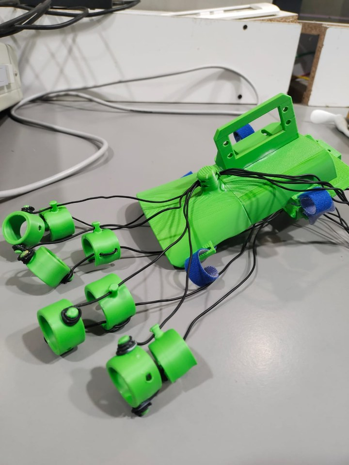
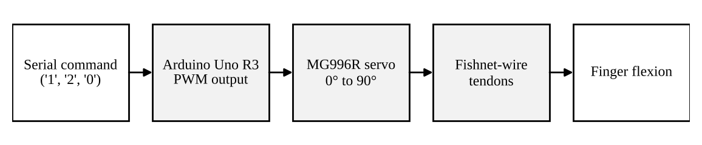
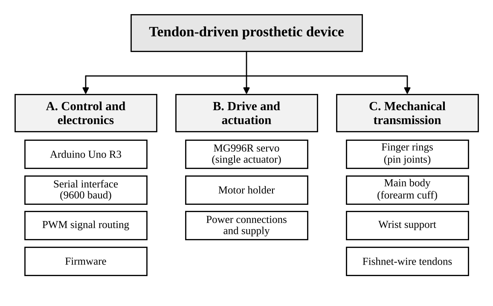
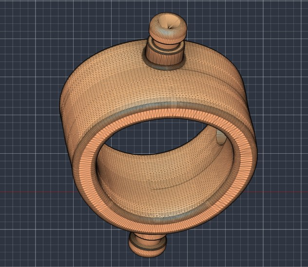
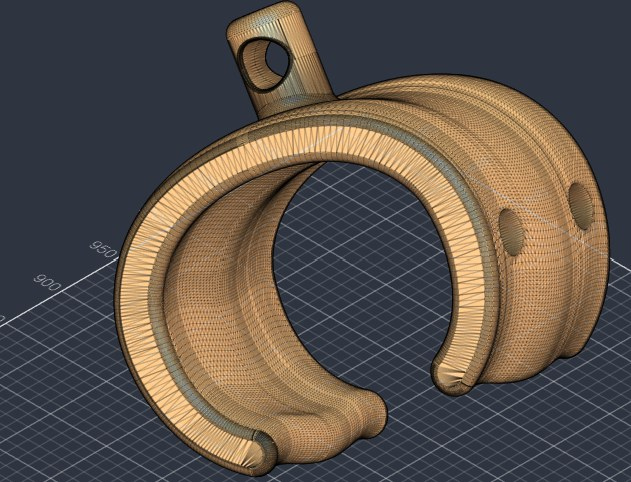
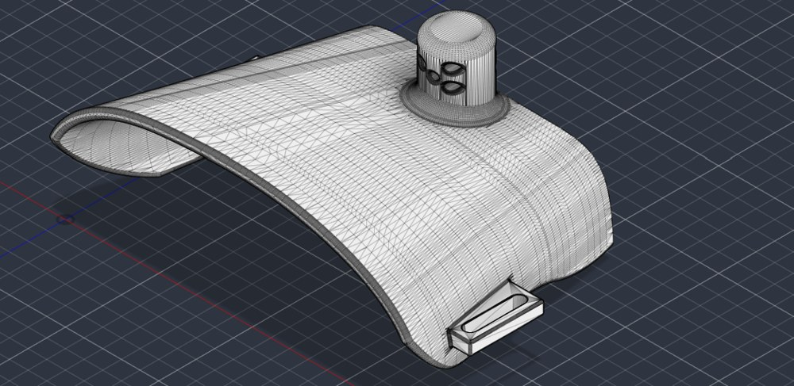
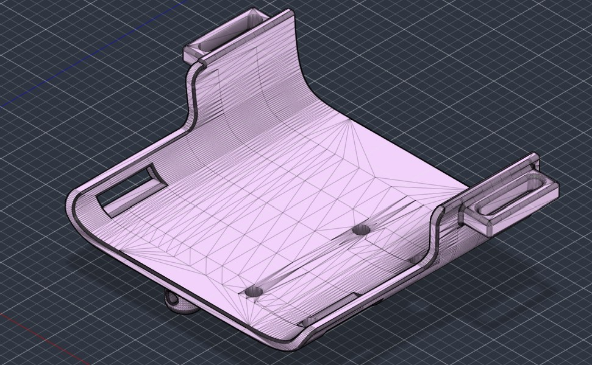
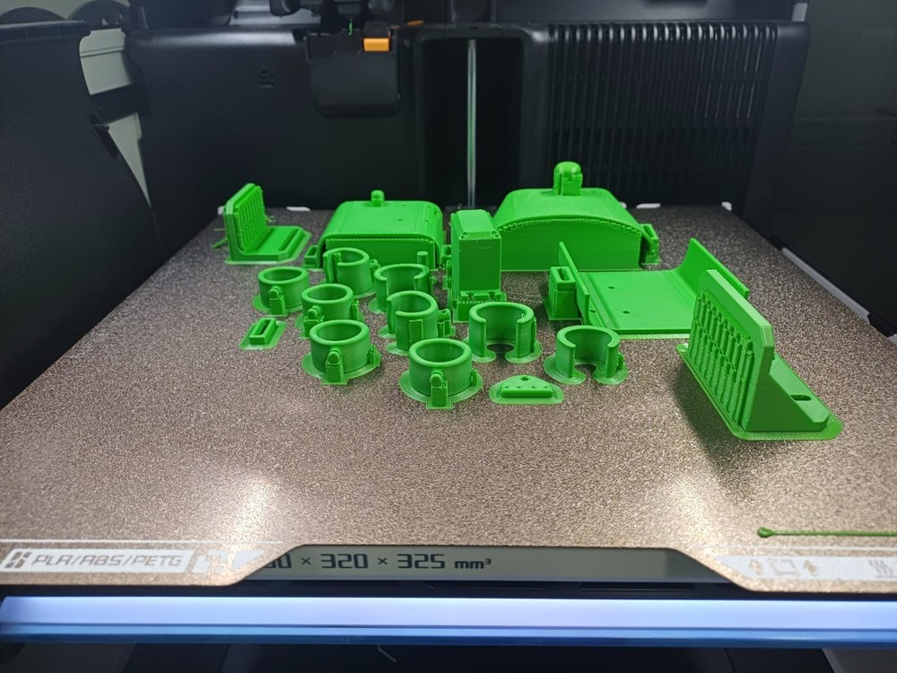

# Tendon-Driven Prosthetic Hand

A low-cost, 3D-printed prosthetic hand and forearm that closes all its fingers from a **single servo motor**. One actuator pulls fishnet-wire tendons through channels printed into the palm and fingers, so the hand stays light, cheap and easy to repair.

Built for **MD6193: 3D Rapid Prototyping and Modelling (2026)** as a reverse engineering mini project.

> **Status:** working proof of concept. It closes and opens on a serial command. There is no grip-force testing, no EMG input and no feedback yet. See [Limitations](#limitations) and [Roadmap](#roadmap).

## Why this exists

Conventional multi-motor prosthetic hands work well but cost a lot, weigh a lot and are hard to service. A tendon-driven hand trades finger independence for simplicity: one motor in the forearm, no motors or electronics in the fingers. The goal here is basic grasp (close around an object, let go) at a price and weight that makes sense for a lot more people.

## How it works

1. **Input.** An Arduino Uno R3 reads single-character commands over serial at 9600 baud.
2. **Actuation.** It outputs PWM to an MG996R servo, which rotates between 0° and 90°.
3. **Transmission.** Fishnet-wire tendons, fixed to the servo, run through printed guide channels in the forearm body, palm and finger rings. As the servo turns, the tendons tighten and bend the fingers.

When the servo returns to 0° the tendon tension is released. There is no dedicated return spring in this version.

## Hardware

| Part | Notes |
| --- | --- |
| Arduino Uno R3 | Runs the firmware, talks to the computer over USB serial |
| MG996R servo | The only actuator, 0° to 90° |
| DC power adapter | Powers the servo directly |
| USB cable (Type-B) | Serial commands from a computer |
| Jumper wires | Signal, power and ground |
| Fishnet wire | Tendons |
| PLA filament | All printed parts, about 181 g for a full plate |

**Power note:** our first attempt used a battery holder and a buck converter. The holder shorted and the converter misbehaved, so the servo now runs straight from a DC adapter. A servo pulls a lot of current under load, so give it a supply rated for that and keep it separate from the Arduino's logic supply (with a common ground).

## Firmware

The firmware is deliberately small.

| Command | What it does |
| --- | --- |
| `1` | Toggles motor channel 1 between 0° and 90° |
| `2` | Toggles motor channel 2 between 0° and 90° |
| `0` | Switches both channels off |

- **Stepped movement.** The servo moves 1° every 15 ms, so a full 90° stroke takes about 1.35 s. This avoids jerking the tendons and the finger joints.
- **Detach protection.** The servo signal line is pulled low on boot so the servo doesn't twitch at power-up.
- The code defines two channels, but the hand as built uses one servo.

## CAD and printing

All parts were modelled in Autodesk Fusion and printed in PLA.

| Part | What it does |
| --- | --- |
| Finger rings | Ring-shaped segments joined by pins, with tendon channels |
| Main body (wrist) | Tapered forearm cuff with strap anchors |
| Motor holder | Holds the servo inside the forearm body |
| Wrist support | Links cuff and palm, carries strap loops and tension guides |

  
  
  
  

**Print settings we used**

| Setting | Value |
| --- | --- |
| Printer | Bambu Lab H2D (FDM) |
| Material | Generic PLA |
| Nozzle | 0.4 mm |
| Profile | 0.20 mm Standard |
| Infill | 40% |
| Build plate | Textured PEI |
| Initial layer speed | 50 mm/s |
| Outer / inner wall speed | 200 / 300 mm/s |
| Brim | 5 mm, 0.1 mm gap |
| Layers / time | 578 layers, 8 h 2 min |
| Filament | 60.57 m (180.64 g) |

## Build notes

Two things went wrong, and both are worth knowing about before you print your own.

- **Tendon channels come out undersized.** FDM parts shrink as they cool, so the small channel holes closed up and the wire bound. We fixed it by reaming the channels with a conical soldering tip, with no reprint. A better fix is to enlarge the channels in CAD (print a small test piece first to find the offset).
- **Battery and buck converter setup failed.** See the power note above.

## Limitations

- One servo means no independent finger control and no complex grips.
- Tendon friction in the printed channels reduces the pull that reaches the fingertips.
- FDM layers bond more weakly than the material itself, which limits how much tendon pull the rings and pin joints can take.
- Control is by serial command only. No muscle-signal input, no grip-force sensing.
- No quantitative testing yet (grip force, closing time, durability).

## Roadmap

Small fixes (same architecture):

- [ ] Compensate for shrinkage in the channel dimensions in CAD
- [ ] Smoother, larger-radius channels, optionally lined with tubing
- [ ] Elastic return along the back of each finger
- [ ] Adjustable tendon anchor
- [ ] Button input so it works without a computer
- [ ] Regulated, properly rated servo supply

Bigger changes (new architecture):

- [ ] Surface EMG sensing on biceps and triceps
- [ ] Onboard classifier for grip modes
- [ ] Differential (equaliser) tendon linkage so fingers adapt to object shape
- [ ] Fingertip force-sensitive resistors for closed-loop grip
- [ ] Parametric CAD so the hand can be rescaled for different users

## Authors

- Harsh Mundhada
- Anurag Singh

## Acknowledgements

Developed as part of the MD6193 course, 3D Rapid Prototyping and Modelling (2026).
